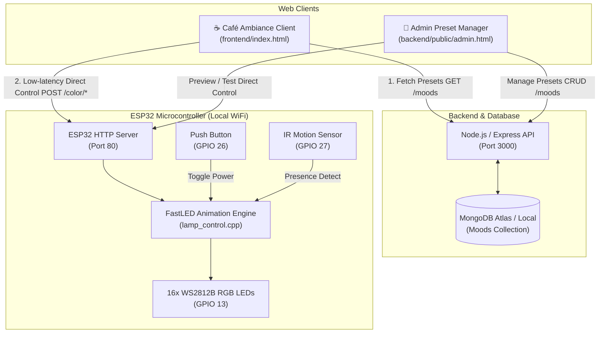

# 🌟 Smart IoT Mood Lamp System (`Mood`)

[](https://www.espressif.com/en/products/socs/esp32)
[](https://nodejs.org/)
[](https://www.mongodb.com/)
[](https://github.com/FastLED/FastLED)
[](frontend/)
[](LICENSE)

An end-to-end IoT ambient lighting system engineered for cafes, study spaces, and home environments. The system pairs an **ESP32 microcontroller** driving **16 addressable WS2812B RGB LEDs** with a **Node.js/Express + MongoDB backend** for persistent mood storage, and an elegant **Café Ambiance web dashboard** for instant real-time lighting control.

---

## 🏗️ System Architecture



---

## 📂 Monorepo Structure

| Directory | Component | Purpose | Detailed Guide |
|---|---|---|---|
| [`esp-code/`](file:///Users/atharvasharna/Desktop/Mood/esp-code/) | **ESP32 Firmware** | C++ Arduino code driving WS2812B LEDs, button debouncing, IR sensor, and REST API | [Firmware README](file:///Users/atharvasharna/Desktop/Mood/esp-code/README.md) |
| [`backend/`](file:///Users/atharvasharna/Desktop/Mood/backend/) | **Cloud/Local API & Admin** | Express.js REST API, MongoDB Mongoose schema, seed script, and static Admin CMS | [Backend README](file:///Users/atharvasharna/Desktop/Mood/backend/README.md) |
| [`frontend/`](file:///Users/atharvasharna/Desktop/Mood/frontend/) | **Web Controller** | Responsive Café Ambiance UI with live mood cards, speed slider, and brightness control | [Frontend README](file:///Users/atharvasharna/Desktop/Mood/frontend/README.md) |

---

## ✨ Key Features

### 1. Hardware & Firmware Capabilities
- **16 Addressable WS2812B LEDs:** Individual sub-pixel color blending with FastLED.
- **Dual Lighting Modes:**
  - *Single Color:* Instant solid illumination.
  - *Multi Color:* Smooth, continuous cross-fading through custom color palettes.
- **Dynamic Transition Speed:** Configurable frame interpolation from 3ms to 200ms.
- **4 Master Brightness Presets:** Ultra-Low (25), Low (64), Medium (128), and High (255).
- **Physical Controls:**
  - Tactile button toggle on `GPIO 26` with 100ms software debouncing.
  - Digital IR motion sensor on `GPIO 27` for presence-activated lighting.
- **Visual Wi-Fi Feedback:**
  - Cyan breathing sine wave during connection attempts.
  - Smooth green fade-out animation upon successful Wi-Fi link.
- **Offline Reliability:** 8 hardcoded fallback presets (Focus, Cozy, Social, Golden Hour, Late Night, Rainy Day, Creative Flow, Romantic) baked into firmware.

### 2. Cloud & Management Capabilities
- **RESTful Preset Management:** Full CRUD operations on mood presets via Express & MongoDB.
- **Admin CMS Dashboard (`/admin.html`):** Visual color pickers for single and multi-color palettes.
- **Database Seeding (`seed.js`):** Ships with 7 curated default palettes (Golden, Rainy, Focus, Night Light, Forest, Ocean, Galaxy).

### 3. User Interface Capabilities
- **Café Ambiance Web Client:** Elegant design with Google Fonts (*Playfair Display* & *Lato*).
- **Decoupled Configuration:** Real-time editing of Backend URL and ESP32 IP directly in the settings panel.
- **Full Responsiveness:** Optimized for desktops, tablets, and smartphones.

---

## 🔌 Hardware Wiring & Pinout

```
                           ESP32 Dev Module
                        ┌──────────────────┐
                        │              3V3 │
                        │              GND │ ──── COMMON GND
                        │           GPIO13 ├─── [330Ω - 470Ω] ─── DIN (WS2812B Strip)
                        │           GPIO26 ├─── [Tactile Button] ─── GND
                        │           GPIO27 ├─── OUT (IR Motion Sensor)
                        │              5V  │ ──── (Power input if powered via USB)
                        └──────────────────┘
```

| Component | ESP32 Pin | Mode | Description |
|---|---|---|---|
| **WS2812B Data In** | `GPIO 13` | Output | Data signal driving all 16 RGB LEDs |
| **Push Button** | `GPIO 26` | `INPUT_PULLUP` | Active-low manual on/off power toggle |
| **IR Motion Sensor** | `GPIO 27` | `INPUT_PULLUP` | Detects customer presence to automatically activate lamp |
| **External Power** | `5V` & `GND` | Power | **Recommended:** Dedicated 5V 2A external DC power adapter |

> [!NOTE]
> Ensure a common ground connection exists between the ESP32 and the external 5V power supply powering the LED strip.

---

## 🚀 Quick Start Guide

### Step 1: Flash the ESP32 Firmware
1. Open the [esp-code](file:///Users/atharvasharna/Desktop/Mood/esp-code/) directory in **Arduino IDE**.
2. Open [`wifi_config.h`](file:///Users/atharvasharna/Desktop/Mood/esp-code/wifi_config.h) and set your Wi-Fi credentials:
   ```cpp
   const char* WIFI_SSID = "YOUR_WIFI_NAME";
   const char* WIFI_PASSWORD = "YOUR_WIFI_PASSWORD";
   ```
3. Install required libraries (**FastLED** and **ArduinoJson**) via the Arduino Library Manager.
4. Select your board (**ESP32 Dev Module**) and serial port, then click **Upload**.
5. Open Serial Monitor at **115200 baud** and note the assigned IP address (e.g. `http://192.168.1.150`).

*Detailed instructions:* [esp-code/README.md](file:///Users/atharvasharna/Desktop/Mood/esp-code/README.md)

---

### Step 2: Start the Backend & Seed Database
1. Open a terminal and navigate to the backend directory:
   ```bash
   cd backend
   npm install
   ```
2. Configure `.env` from `.env.example`:
   ```bash
   cp .env.example .env
   ```
   *(Ensure `MONGODB_URI` points to your local or MongoDB Atlas instance)*.
3. Seed the default mood palettes:
   ```bash
   npm run seed
   ```
4. Start the backend:
   ```bash
   npm start
   ```
   *Backend is now running at `http://localhost:3000` (Admin panel at `http://localhost:3000/admin.html`).*

*Detailed instructions:* [backend/README.md](file:///Users/atharvasharna/Desktop/Mood/backend/README.md)

---

### Step 3: Launch the Frontend Web Client
1. Serve the `frontend/` directory with any static server:
   ```bash
   cd frontend
   python3 -m http.server 8080
   # Or use VS Code Live Server
   ```
2. Open `http://localhost:8080` in your browser.
3. In the **Settings** panel at the bottom:
   - Set **Backend URL** to `http://localhost:3000`.
   - Set **Device IP** to your ESP32's IP (e.g., `http://192.168.1.150`).
4. Click any mood card's **Single Color** or **Multi Color** button to control the physical lamp!

*Detailed instructions:* [frontend/README.md](file:///Users/atharvasharna/Desktop/Mood/frontend/README.md)

---

## 📡 REST API Reference Summary

### Backend API (Port 3000)
| Method | Endpoint | Description |
|---|---|---|
| `GET` | `/health` | Server health check |
| `GET` | `/moods` | Retrieve all custom moods from MongoDB |
| `POST` | `/moods` | Create a new mood `{ name, singleColor, multiColors }` |
| `PUT` | `/moods/:id` | Update an existing mood |
| `DELETE` | `/moods/:id` | Remove a mood |

### ESP32 Microcontroller API (Port 80)
| Method | Endpoint | Payload / Description |
|---|---|---|
| `POST` | `/color/single` | `{"r": 255, "g": 215, "b": 0}` — Set solid color |
| `POST` | `/color/multi` | `[{"r": 255, "g": 0, "b": 0}, ...]` — Set animation palette |
| `POST` | `/color/speed` | `{"speed": 20}` — Set transition delay in ms |
| `POST` | `/ir/toggle` | `{"enabled": true}` — Enable/disable motion sensor |
| `GET` | `/brightness/:level` | `:level` can be `ultra-low`, `low`, `medium`, `high` |
| `GET` | `/:preset/:mode` | Hardcoded presets (`/focus/single`, `/cozy/multi`, etc.) |

---

## 🎓 Viva & Presentation Resources

Preparing for an oral examination, project showcase, or technical presentation?
A comprehensive 590-line technical viva document detailing every C++ function, electrical principle, debouncing algorithm, and architectural decision is available in:
- [esp-code/PROJECT_OVERVIEW.md](file:///Users/atharvasharna/Desktop/Mood/esp-code/PROJECT_OVERVIEW.md)

---

## 📄 License

This project is licensed under the MIT License — see the repository files for details.
